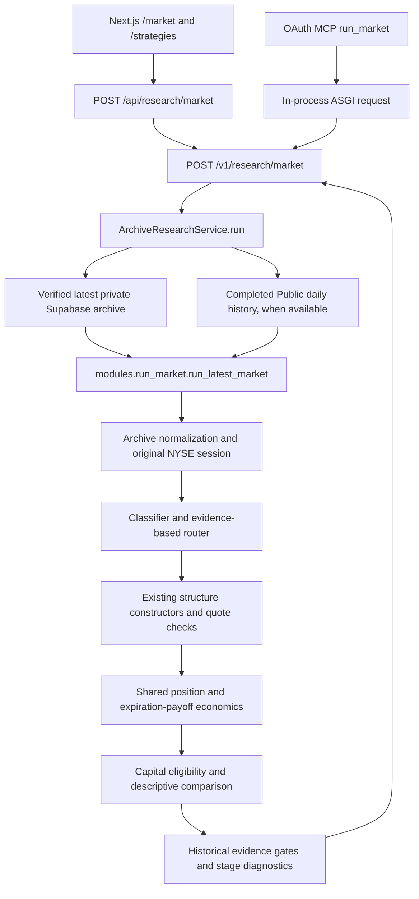

# AlphaOS Release 1.5 architecture and consolidation inventory

Audited October 16, 2026, starting from `main` at
`d1c9e087a3dbf09490fd113d095c004fecdac738` (PR #44 merged).
This is an inventory and behavior-preserving cleanup, not a new research engine.

> **Currency update (2026-10-24).** The audit below remains the dated
> 2026-10-16 record. Three current facts have moved:
>
> - `main` is now `76a6a16` (merge of PR #64). PRs #61-#64 changed request
>   budgeting and cancellation, response encoding and the dashboard contract;
>   the documented strategy families, routing evidence gates, expiry matching and
>   freshness policy are unchanged.
> - The operation set is now **20 paths**: `/health` plus **19 authenticated
>   `/v1` operations**, because PR #63 added `POST /v1/research/observation`. The
>   19/18 figures below were correct at audit time and are asserted today by
>   `tests/test_architecture_consolidation.py`. MCP still exposes **17 tools**;
>   the observation route is dashboard-only.
> - [architecture-branches.json](architecture-branches.json) remains the
>   2026-10-16 snapshot of 48 heads. The remote had **68** heads on 2026-10-24;
>   they are not reclassified here.
>
> Production is reported at `76a6a16` with PR #64 deployed (owner-confirmed, not
> independently verified in this repository). See [current status](STATUS.md).

Release 1.5B starts from PR #45 merge
`18655f055a7667706f639c83bfb4ef3de75b7d99`. It consolidates only the pure SDK
option-row formatter shared by the headless and Streamlit adapters. See
[provider consolidation](PROVIDER_CONSOLIDATION.md) for traced callers, preserved
failure/cache boundaries, validation and the next migration. The deployment audit
below remains dated evidence; this code change does not assert a new deployment.

Release 1.5C starts from PR #46 merge
`74eabb42f3226b1fbb354991040b60ed9bede49d`. It shares only the repeated
explicit legacy vertical service sequence, preserving both response contracts,
all REST/MCP declarations and dependency scopes. See
[legacy contracts and dependency inventory](LEGACY_CONTRACTS_DEPENDENCIES.md)
for compatibility evidence and the Release 1.5D migration boundary.

## Canonical general research pipeline

The authoritative general SPY/QQQ workflow is **archive-backed `run_market`**.
The website is a presentation/validation bridge. MCP calls the same authenticated
REST handler in process; it does not calculate a second result.



Call path, with ownership:

| Layer | Implementation and invariant |
|---|---|
| Website | `web/src/components/market/MarketResearchPanel.tsx` submits explicit controls and displays backend evidence. `web/src/app/strategies/page.tsx` reexports the market page. |
| Web bridge | `web/src/app/api/research/market/route.ts` validates allowed inputs, sends the server-side bearer token, preserves the v2 envelope, and sanitizes known failures. `/api/strategies` reexports/delegates to this bridge for compatibility. |
| MCP | `alphaos_api/mcp_server.py:run_market` constructs `MarketRequest`; `invoke` uses `httpx.ASGITransport` against the same app, including REST validation and error handling. OAuth scopes and owner consent remain mandatory. |
| REST contract | `alphaos_api/research2.py:register_research2` and `ArchiveResearchService.run`; `MarketRequest` owns input validation. The service verifies archive evidence before loading daily history. |
| Trusted storage | `modules/supabase_archive.py:read_latest_option_snapshot` verifies latest-row selection, availability, SHA-256, symbol/provider/session/slot, path and quality. No older-complete-snapshot or live-chain fallback. |
| Normalization | `modules/market_archive_adapter.py:normalize_archive_snapshot` selects an explicit archived expiration and preserves contract quality, timestamps and counts. |
| Orchestration | `modules/run_market.py` resolves the observation's NYSE session and retains observation time separately from request time. |
| Classification/routing | `opportunity_classifier.py` and `opportunity_router.py`; unknown dimensions remain unknown. No-route automatic discovery can test both existing debit hypotheses, explicitly labeled unclassified quote-supported research. |
| Construction | `opportunity_session.py` coordinates `long_option_discovery.py`, `structure_research.py:discover_debit_spreads`, reused `options_suggestions.py:_debit_spread`, and `premium_engine.py:generate`. Quotes, observed-delta selection, fees and geometry keep their existing gates. |
| Economics | `position_research.py`, `long_option_research.py`, `structure_research.py` and `options_payoff.py`; `historical_economics.py`, `structure_economics.py` and `trusted_historical_adapter.py` retain evidence provenance and entry/horizon alignment. |
| Results | `strategy_compare.py` is descriptive, never a ranking. `run_market.py:attach_market_economics` preserves unavailable entry-aligned economics. Stage counts and exclusion reasons pass unchanged through REST, MCP and the website. |

`current` remains the default with strict configured archive freshness (600-second
default) and request-date expiration checks. Explicit `historical` removes only
the current-age ceiling and permits past expirations relative to request time;
it still researches the original observation and rejects missing/corrupt or
inconsistent archives. Neither mode supplies executable quotes or a trade signal.
See [after-hours semantics](RELEASE1_AFTER_HOURS_RESEARCH.md) and
[candidate-generation semantics](RELEASE1_CANDIDATE_GENERATION_DIAGNOSTICS.md).

## Active surfaces and compatibility boundaries

Production entrypoint: `python -m alphaos_api` -> `alphaos_api/__main__.py:main`
-> `uvicorn` -> `alphaos_api.app:app`, one worker. `/v1` uses bearer authentication.
The MCP transport uses OAuth and invokes REST with the internal server token;
none of the tool interfaces accepts user credentials as research arguments.

The deployed OpenAPI operation set was read directly and compared with local
runtime metadata: **19 operations**, including `/health` and **18 authenticated
`/v1` operations**. All are retained. Runtime metadata confirms **17 MCP tools**,
also retained. The detailed methods, operation IDs, sources, signatures and MCP
REST targets are in [the machine inventory](architecture-inventory.json).

| Surface | Status and path |
|---|---|
| Archive general research | Canonical: `POST /v1/research/market`; MCP `run_market`. |
| Explicit supported structures | Active: `POST /v1/research/structure` and `/v1/research/structures/compare`; MCP `research_structure`, `compare_structures`. Shares payoff/evidence modules with archive research. |
| Context/quote/options | Compatibility but active: `GET /v1/market/{symbol}`, `/structure/{symbol}`, `/distribution/{symbol}`, `/quote/{symbol}`, `/options/{symbol}/expirations`, `/options/{symbol}/chain/{expiration}`, `/options/{symbol}/vertical`, `/options/{symbol}/scan`, `/candidates/{candidate_id}`. |
| Explicit legacy verticals | Compatibility but active: `POST /v1/trade/research`, `/v1/trade/compare`; distinct `TradeRequest`, horizon/method/friction conventions. |
| Unified legacy presentation | Compatibility but active: `/v1/research/{symbol}/run`, `/v1/research/candidates/{candidate_id}`, `/v1/research/{symbol}/vertical`, `POST /v1/research/trade`; `phase9.py`, `phase9_routes.py`, `unified_trade.py`. |
| Legacy MCP tools | Retained: `market_snapshot`, `price_structure`, `forward_distribution`, `live_quote`, `option_expirations`, `scan_credit_spreads`, `research_candidate`, `research_vertical`, `research_explicit_trade`, `compare_trades`, `run_symbol_research`, `unified_candidate_research`, `unified_vertical_research`, `unified_explicit_trade_research`. |
| Web pages | `/`, `/dashboard`, `/market`, `/strategies`, `/structures`, `/journal`, `/risk`, `/session`, `/settings` remain. Journal/risk/settings are read-only placeholders, not verified account state. |
| Web APIs | `/api/health` (GET), `/api/market` (GET), `/api/research/market` (POST), `/api/research/structure` (POST), `/api/research/structures/compare` (POST), `/api/strategies` (GET/POST). |
| Explicit structure web path | `/structures` submits legs and one signed package cashflow to `/api/research/structure` and `/api/research/structures/compare`, which forward to the two `/v1` structure operations with the server-side token. The bridge validates the returned envelope; it adds no pricing, payoff, ranking or capital assessment. |
| Dashboard/context web path | Intentionally separate active compatibility presentation: `alphaos-server.ts:getMarketSnapshotServer` -> `/v1/market` + `/v1/structure` paired by snapshot ID; not the candidate engine and not a silent fallback for archive errors. |
| Public protocol routes | `/openapi.json`, `/docs`, `/redoc`, OAuth discovery/authorization/register/token/revoke/consent and MCP mounted transport remain. The MCP SDK provides protected-resource discovery. `/health` is process health, not market evidence health. |

There is one canonical **general archive pipeline**, not a claim that all legacy
tools already have identical semantics. Forcing those compatibility workflows
through the archive request model would change contracts and needs migration.

## Legacy, duplicate and removal decisions

Import evidence includes local/lazy imports, test imports and Streamlit's automatic
`pages/` discovery. A matching function body is not sufficient reason to merge it:
module globals, symbol policies, caching, credentials and callers may differ.

| Components | Classification and decision |
|---|---|
| `app.py`, `streamlit_app.py` | Duplicate three-line launchers, retained compatibility entrypoints. Both call `premium_workspace.render`; external Streamlit deployments were not inventoried by Render and may depend on either filename. |
| `pages/` and workspace modules | Active legacy UI. Scanner uses `market_data`; Strategy Selector and root use `premium_workspace`; Quant Lab dispatches its retained research workspaces; settings uses guardrails/Alpaca configuration. Keep. |
| `public_data.py`, `public_provider.py`, `daily_public.py`, `public_session.py`, `public_history.py` | Distinct lifecycle boundaries: Streamlit secrets/cache and portfolio reads; headless server market data; collector; shared account selection; historical transport. Release 1.5B shares only SDK option-row formatting through `public_option_quote.py`, retaining `_option_quote_row` wrappers and local numeric hooks. Credentials, request policy, caches, raw archive normalization and other helpers remain separate; see the provider consolidation record. |
| `phase6_*`, `selector_research.py`, `option_scenario_ev.py`, `threshold_survival.py` | Older names, but imported by the active `ResearchService` and shared structure/history paths. Required compatibility/research primitives, not obsolete phases. |
| `options_income.py`, `options_suggestions.py` | Required by current structure discovery. Retain legacy selector behavior, including observed-delta gates, and avoid importing UI scoring into canonical research. |
| `_number` helpers and timestamp/freshness functions | Some exact duplicates, others intentionally differ on booleans/nonfinite input or observation versus quote time. Keep; no global validation rewrite in this PR. |
| `contracts.py:friction` | Cleaned: shared identical extraction for the two explicit-trade REST handlers. `app.friction` remains available via import; validation/defaults and all three cost fields are unchanged. |
| `disabled_pages/`, `metrics.py`, `strategies.py` | Not automatically loaded by Streamlit. Some modules have only these retained consumers. Deprecated UI paths, preserved rather than deleting historical/account-related functionality. |
| `public_observations.py` | Test-referenced alternate observation adapter, not the archive collector or canonical API path. Retained for a separate retirement decision. |
| `income_risk.py`, `mock_market.py`, `signal_quality.py`, `trade_analyzer.py`, `unified_trade_view.py` | No incoming tracked imports found; string searches and definitions inspected. Unreferenced in-repo, but not declared safe for external consumers. Retained; no speculative Python module deletion. |
| `CandidateCard.tsx`, `PayoffDiagram.tsx` | Removed. No page/route imports, reexports, dynamic references or tests consume the card; the diagram's sole consumer was that card. The unused client-side payoff rendering is gone; canonical backend economics are unchanged. |
| `mock-data.ts`, `types/research.ts` | Retained. Dashboard explicit demo mode still imports `MOCK_MARKET_SNAPSHOTS`. Unused candidate/portfolio examples, guardrail presets and associated types are not production evidence and were not deleted as part of data/configuration cleanup. No actual data or trade record was removed. |
| SQL, manifests, archive data, secrets/configuration | Preserved without changes. Website journal remains unconnected; ledger SQL is not an active application write path. |

## Repository, documentation and test inventory

[architecture-inventory.json](architecture-inventory.json) contains each tracked
Python module's internal imports, lazy imports, external import roots and root
reachability groups; all web imports/routes; possible duplicate bodies; dependency
declarations; documentation and workflow lists. It is a **conservative static
working-tree inventory over the baseline**, not proof that every transitive or
lazy import executes in production. For example, the API uses
`build_research_dataset` from `market_state_research`; its lazy UI-only
`load_market_state` can import Streamlit's `public_data`, but the API's actual
provider path does not require Streamlit.

Rebuild after staging tracked-file additions/removals:

```sh
python -m scripts.inventory_architecture --baseline <audited-base-sha> > docs/architecture-inventory.json
```

The tool imports no application code, opens no credentials, performs no network
requests and makes no removal decisions. Changing this inventory does not change
any runtime route or import. It must be paired with call-path review and runtime
metadata, as done in this audit.

Documentation authority:

- [STATUS.md](STATUS.md): dated record of merged work, reported production state
  and open Issue #60 acceptance.
- This document: current code ownership, status and cleanup decisions.
- [DEPLOYMENT.md](DEPLOYMENT.md): audited services, real dependency map and deployment boundaries.
- `RELEASE1_AFTER_HOURS_RESEARCH.md`, `RELEASE1_CANDIDATE_GENERATION_DIAGNOSTICS.md`:
  active research semantics and observed limitations, not alternative engines.
- `MCP.md`, `RESEARCH_API.md`, `ALPHAOS2_API_MCP.md`, `QUOTE_FRESHNESS.md`,
  `HISTORICAL_ECONOMICS*.md`, `alphaos2_archive_research.md`, scheduler/archive docs:
  detailed contracts; implementation/runtime metadata wins if an older example differs.
- `PRODUCTION_READINESS.md`, build-status, release gates, phase reports, PR inventory
  and reconciliation docs: dated audit/handoff evidence, retained historical records.
  Their recorded commits/deployments are not the current control plane.

Tests remain split by contract: payoff/structure and historical evidence;
archive/collector integrity; classifiers/routing/diagnostics; current/historical
REST and OAuth MCP parity; legacy quote/scan/unified compatibility; Streamlit UI;
website bridge/unit tests; Playwright navigation/research cases. New focused
consolidation tests guard the full 19-route/17-tool compatibility surface and
identical explicit-trade friction forwarding. Inventory tests cover lazy/relative
imports, reexports and dynamic web imports without executing inspected code.

## Branches and separate migrations

[architecture-branches.json](architecture-branches.json) records 48 remote heads:
18 ancestors of the baseline (including `main`), 30 not ancestors. All remain.
The staging API's selected `release/release1-consolidation` branch is still an
active deployment reference. Ancestry alone does not account for squash merges,
cherry-picks, worktrees or external deployments. Local historical branches and
worktrees also remain; this PR does not archive or switch other checkouts.

Separate, explicitly scoped migrations are required for:

1. Retiring any legacy MCP/REST contract or routing its clients to archive semantics.
2. Provider/cache/auth lifecycle consolidation and removal of unreferenced Python APIs.
3. Personal identity, persistent journal/RLS or brokerage-account integration.
4. Dependency locking/upgrades, direct declarations for transitive imports, React
   upgrade, reviewed audit exceptions, and devcontainer/runtime alignment.
5. Reconciling staging Blueprint drift or changing service branches/settings.
6. Remote-branch or worktree deletion, after owner/deployment review.

No strategy, ranking, classification, pricing, freshness or research-result change
is included. No data/configuration/secret/service/remote branch was deleted, no
service setting changed, and no merge or deployment was performed.
