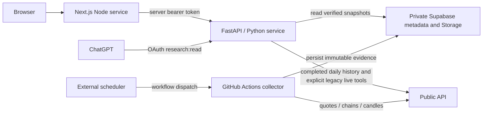

# Audited deployment and dependency map

Read-only control-plane audit: October 16, 2026. Both user-facing services are
manually deployed at `d1c9e087a3dbf09490fd113d095c004fecdac738` (main after PR #44).
Names are service identifiers, not guarantees that a service is unused: the
website's service is named **alphaos-web-staging** but is the current user-facing
research website inspected in the Release 1 work.

| Render service | Live origin / region | Selected branch and live commit | Build / start | Health and scaling |
|---|---|---|---|---|
| AlphaOS (`srv-daqillmgekts73ak0mj0`) | `https://alphaos.onrender.com`, Virginia | `main`, `d1c9e087...` | `pip install -r requirements-api.txt` / `python -m alphaos_api` | `/health`; one instance; app enforces one worker; automatic deployment off |
| alphaos-web-staging (`srv-db6iok3rjlhs73eveqs0`) | `https://alphaos-web-staging.onrender.com`, Virginia | `main`, `d1c9e087...` | `cd web && npm ci && npm run build` / `cd web && npm start` | No configured Render health path in the inspected service; `/api/health` exists; one instance; automatic deployment off |
| alphaos-api-staging (`srv-db6mql2d0e5s73atk5e0`) | `https://alphaos-api-staging.onrender.com`, Oregon | `release/release1-consolidation`, `15dc5683...` | `pip install -r requirements-api.txt` / `python -m alphaos_api` | `/health`; retained separate service; automatic deployment off |

The live staging commit can differ from its selected branch head. The checked-in
`render.staging.yaml` names another branch (`web/research-api-integration`) and an
86400-second archive ceiling. It is historical staging configuration, **not the
observed production configuration**. This audit changes neither file nor service.
Reconciliation needs a separate approved migration; do not apply that Blueprint
as a replacement for current settings.

## Release 1.5B code dependency update

From PR #45 main (`18655f055a7667706f639c83bfb4ef3de75b7d99`), both
`public_provider` and legacy `public_data` depend on the standard-library-only
`public_option_quote` formatter. This adds no package, credential, service, request,
cache or fallback. The collector still uses raw-response `DailyPublicProvider` and
`options_archive.normalize_contract`; verified archive reads remain separate.
See [the provider trace and migration boundaries](PROVIDER_CONSOLIDATION.md).
This is a source-code update, not a fresh Render audit or deployment.

## Actual application dependencies

The website does not read Supabase directly and does not contain API secrets in
client code. Its backend authentication is server-to-server, not personal user
identity or a journal/account session. Website risk/journal/settings placeholders
do not establish brokerage balances, positions or active guardrail enforcement.
There is no production order-execution or journal-write route in the inspected API.

Required wiring (names only; this audit did not retrieve or change values):

| Process | Configuration ownership and effect |
|---|---|
| Website | `ALPHAOS_API_URL` and secret `ALPHAOS_API_TOKEN` are server-side. The Release 1 endpoint was observed targeting the AlphaOS backend through paired authenticated responses; stored Render values were not read in this audit. `ALPHAOS_DEMO_MODE=true` affects explicitly labeled dashboard demo context only; normal archive research never uses mock candidates. |
| API | `ALPHAOS_API_TOKEN` gates REST. `PUBLIC_API_SECRET` and `PUBLIC_ACCOUNT_NUMBER` support daily history and legacy live tools. `SUPABASE_URL` and `SUPABASE_SERVICE_ROLE_KEY` are trusted server-only archive credentials. `ALPHAOS_ARCHIVE_MAX_AGE_SECONDS` configures current-mode freshness (600 default). `ALPHAOS_PUBLIC_URL` sets OAuth public origin (default `https://alphaos.onrender.com`). `PORT` is validated by the entrypoint. |
| Secret mounts | `alphaos_api/config.py` loads explicitly named API/Public secret files from `/etc/secrets` with environment precedence; Supabase archive wiring reads its environment. No credentials go into research arguments or browser bundles. |
| Collector | `.github/workflows/intraday-archive.yml` dispatches `scripts.run_intraday_snapshot` with GitHub secret mappings. `config/intraday_archive.json` and the authoritative NYSE session gate determine collection. This is separate from deploying the API or website. |
| Legacy Streamlit | `requirements.txt`, `streamlit run streamlit_app.py` (or compatible `app.py`), `.streamlit` settings/secrets and pages. Community Cloud or other external Streamlit deployment state was not confirmed by the Render audit. Retain both entrypoints. |

Never reuse the weaker notion of archive age as executable quote freshness.
Current mode fails closed on stale archives. Historical mode is explicit and
keeps integrity, source and observation time. Dashboard/legacy quote research
has separate quote-quality and snapshot-ID gates. A service cold start or a
successful process-health response is not proof of authenticated market evidence.

## Runtime/install boundaries

| Boundary | Declared dependencies and evidence |
|---|---|
| API deployment | `requirements-api.txt`: FastAPI, Uvicorn, pandas, NumPy, python-dateutil, publicdotcom-py 0.1.17, pandas-market-calendars 5.4.0, tzdata, MCP 2.2.0, Supabase 2.x. No Streamlit/Plotly install is required by the headless request path. |
| Collector | `requirements-daily.txt`: NumPy, pandas, pinned Public SDK/calendar and Supabase 2.32.0. A distinct install scope, not a redundant copy of API requirements. |
| Streamlit | `requirements.txt`: Streamlit, Plotly, Supabase, pandas, NumPy, dateutil, pinned Public SDK/calendar. Retained for legacy UI and UI tests. |
| Shared/transitive imports | Application code also imports `pydantic`, `starlette`, `httpx`, `mcp_types` and `requests`, supplied transitively by current declared packages. Explicit direct constraints/locking need separate compatibility testing, not silent removal here. |
| Python version | CI reads `.python-version` (3.12.14). `runtime.txt` says `python-3.12`; the legacy devcontainer still uses Python 3.11. Configuration is preserved; alignment is a separate migration. |
| Website | Node 22 in CI/deployment instructions; Next 16.4.0, React/React DOM 18, clsx, lucide-react, tailwind-merge. TypeScript, Tailwind/PostCSS and Playwright are build/test dependencies; use committed `package-lock.json` and `npm ci`. React 18 deprecation and the legacy `next lint` script require separate tooling review. |
| CI | `.github/workflows/tests.yml` installs both Python requirement scopes and pytest; the web job runs dependency audits, typecheck, unit/contract tests, production build and Chromium tests. Existing reviewed dev-tool audit exceptions remain unchanged. |

The full exact declarations and import evidence are in
[architecture-inventory.json](architecture-inventory.json). A conservative static
closure can include lazy UI-only imports from shared files; that is not a reason
to add Streamlit to the headless deployment or remove a package from legacy UI.

## Validation and release boundary

The audit compared the live `/openapi.json` operation set with local runtime
metadata (19 operations) and enumerated the same 17 MCP tool names from the
post-PR #44 code. OAuth transport/discovery routes are additional to OpenAPI.
Regression checks preserve authentication declarations, tool read-only metadata,
nonzero-friction forwarding, archive/current/historical behavior and interface
parity. No live account/portfolio state, database migration or secret value was
needed for this inventory.

This consolidation PR does **not** deploy, change Render settings, alter secrets,
upgrade dependencies, change collector scheduling, apply SQL, remove remote
branches or certify a new production release. Older deployment/handoff documents
remain historical evidence; use this map and a fresh control-plane read before
any separately authorized deployment.
