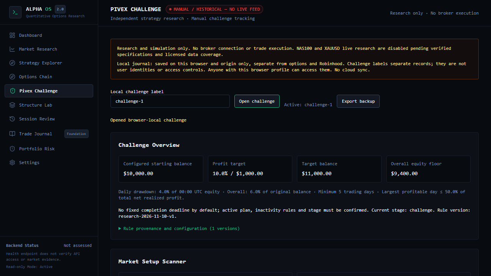
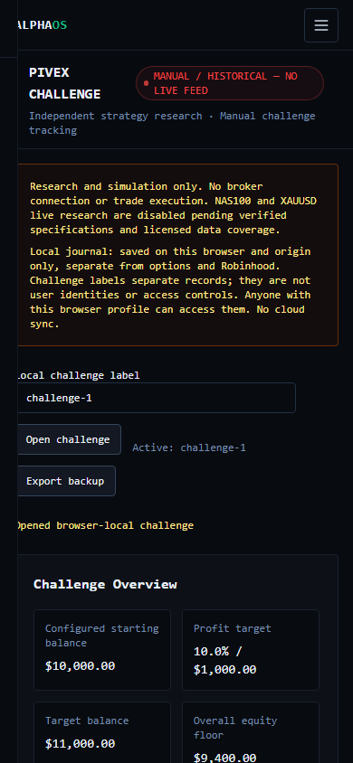
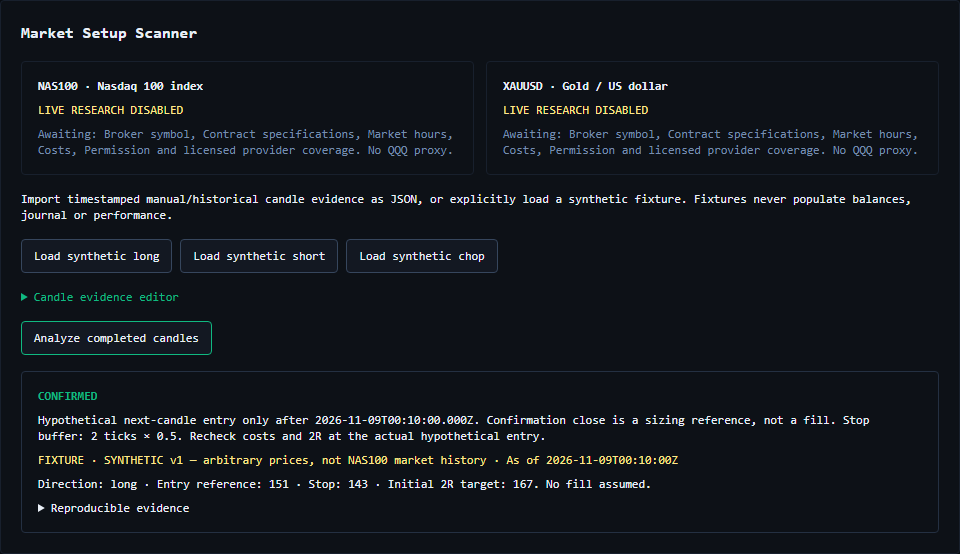
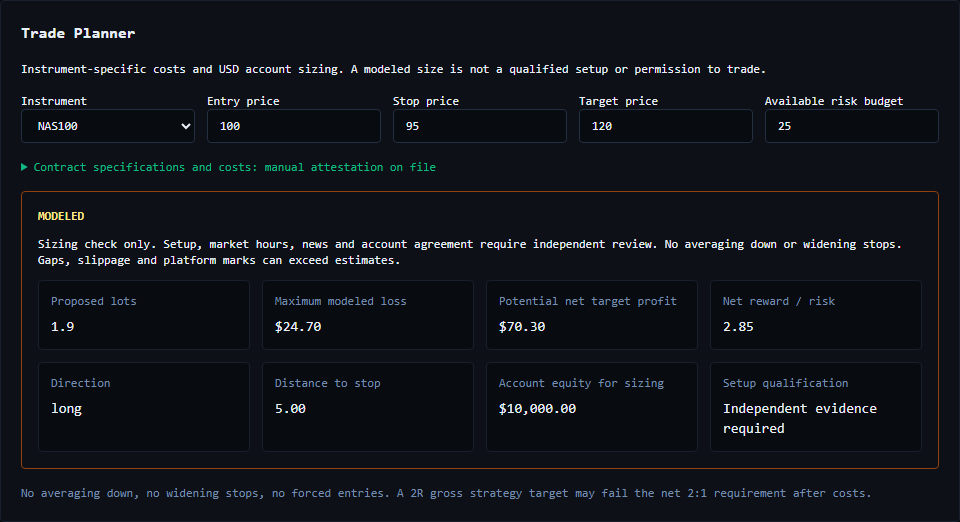

# Pivex Challenge research dashboard

The `/pivex` page adds an independent, manual research and challenge ledger to AlphaOS. It has no trade execution, account API, live CFD feed, background fetch, or options-engine dependency. The only existing website change is the sidebar entry. Options Chain, Strategy Research, charting and infrastructure are untouched.

## Architecture

| Layer | Modules | Responsibility |
| --- | --- | --- |
| Market evidence | `web/src/lib/pivex/evidence.ts` | Extensible instrument registry, replaceable `MarketDataAdapter`, implemented `ManualHistoricalAdapter`, UTC candles, source/mode validation, freshness and alignment checks. |
| Strategy research | `strategy.ts`, `planner.ts` | Pure deterministic signal analysis and cost-aware contract sizing. |
| Challenge management | `challenge.ts`, `journal.ts` | Versioned rule provenance, independently entered account equity/P&L/costs/exposure, personal policy, journal validation/persistence and analytics. |
| UI | `web/src/components/pivex/PivexDashboard.tsx` | Six sections using the existing shell, typography and colors. Explicit evidence input and local save/restore. |

`ChartEvidencePort` is a future interface for displaying validated evidence. It does not import or modify Freebuff's charts. Nothing in this feature imports the SPY/QQQ payoff engine or Robinhood records.

## Evidence and signal definition (v1)

NAS100 and XAUUSD are registry entries, **not verified broker symbols**. Both have live research disabled. There is no QQQ proxy. Users may import historical/manual JSON through the candle editor. Source and mode are retained; the three opt-in synthetic fixtures have arbitrary prices, not NAS100 history. Fixtures never initialize an account or journal.

Each candle has UTC `openTime`, `closeTime`, positive OHLC and `complete: true`. Require contiguous, ordered, nonduplicated bars of exactly 60/15/5 minutes and aligned opening timestamps. A selected timeframe must end less than one bar before its cutoff. Market breaks are conservatively rejected until a verified session calendar can distinguish them from gaps. At least 23 hourly, three setup and two entry bars are required. Conflicting cross-timeframe closing prices are rejected. Bars after the cutoff cannot validate a signal.

1. Freeze hourly and setup evidence at the opening of the five-minute confirmation candle. Seed EMA20 with the first 20 hourly closes, then use alpha 2/21. Last three hourly candles must have increasing highs/lows and price above EMA for long, decreasing highs/lows and price below EMA for short. Otherwise CHOP.
2. For long, the penultimate completed 15-minute bar must be bearish and sweep the prior bar's low; the latest completed bar must be bullish and close above the pullback high. Reverse for short. These are deliberately strict, documented structure definitions, not a claim to reproduce an undisclosed proprietary system.
3. A fresh five-minute close must cross the pullback high/low; the prior five-minute close must be on the other side. Wick-only breakouts fail.
4. Put the stop beyond the more adverse pullback/reclaim extreme plus `bufferTicks * tickSize` (at least one tick). Require a sourced target observed before confirmation starts, with at least 2R room. Propose the first 2R target.
5. Entry is hypothetical **only after confirmation closes**. Its closing price is a reference, never an invented next-open fill. Recompute risk/reward for an eventual hypothetical next-candle entry. The strategy's gross 2R target can fail the planner's net 2:1 requirement after costs.

The expandable evidence result contains the full inputs and outputs for reproduction. Missing data produces UNAVAILABLE; absent setups produce NO SETUP or CHOP. No historical outcome or strategy win rate is inferred from the synthetic signals.

## Sizing and risk conventions

The account currency for this PR is USD. Actual broker specs must be entered and attested, including instrument permission, broker symbol, market hours, min/max lots, lot increment, tick size, tick value per lot in quote currency and quote-to-USD rate. Cost evidence must explicitly cover spread, slippage, commission and fixed fees, even when zero. Spec/cost attestations expire for sizing after 24 hours. This does not enable live data or automatically validate whether the market is open.

Per-lot adverse price loss is `abs(entry-stop) / tickSize * tickValue * FX`. Add round-trip spread/slippage in ticks converted to USD, per-lot round-trip USD commission and fixed round-trip USD costs. Subtract these costs from target profit. Round size **down**, anchored at the minimum lot and bounded by maximum lot. Proposed maximum modeled loss must fit all available budgets, and **net** reward/risk must be at least 2. Position size is rendered without rounding away small lot increments.

The budget is the minimum of the user's available amount, $25 per trade, $25 minus open planned risk, personal daily/weekly allowances minus open risk, and daily/overall equity headroom minus open risk. Reject at three trades/day or two losing trades/day. Personal stops are $60/day and $150/week; profits never expand these budgets. Personal policy is separate from the configurable research rules.

The initial research rules are $10,000 original balance, 10% target, 6% static overall drawdown ($9,400 floor), 4% of exact 00:00 UTC equity for the daily floor, five trading days, day-based 50% consistency and no fixed deadline. New configurations append distinct rule versions and invalidate the current observation. Each journal entry retains its rule version. The active agreement can differ.

An account observation requires an evidence reference and explicit attestation of **all** equity, floating P&L, cumulative gross realized P&L, cumulative fees, USD notional exposure, open planned risk, UTC daily baseline, Monday UTC baseline and complete daily trade/loss counts. Equity is independently entered from platform marks, never inferred from closed profits. Baselines must be exact 00:00 UTC timestamps for their day/week. Observations expire for pre-trade sizing after 15 minutes, fail closed at UTC rollover, and are invalidated after adding a journal trade. Snapshot metrics retain their observation timestamp. Reconfirm after any account change; this app has no way to detect external positions or losses.

The app never says official compliance has passed: point observations cannot prove continuous mark-to-market drawdown compliance. Gaps, actual slippage, financing, platform prices and broker-specific rules can exceed the modeled loss. Minimum-day/consistency statistics from the local ledger cannot establish a complete account record or qualify an upgrade. Profit-target progress uses independently entered gross realized P&L minus fees, separately from equity drawdown checks.

## Storage and authorization boundary

Existing AlphaOS website authentication protects `/pivex` on the existing gated production entrypoints. The feature changes no auth or deployment configuration. Node/Next browser tests use the existing local rendering harness; a separate deterministic test exercises the real `protectWebsite` gate with anonymous, signed and wrong-origin sessions. No auth bypass is added.

The existing website journal explicitly lacks authorized account-scoped server persistence. Consequently this PR persists manual records in **browser localStorage**, namespace `alphaos:pivex:local:v1:<challenge-label>`. It adds no database or service credentials. Labels isolate challenge records from each other and from other product records; they **are not identities, row-level security or multiuser authorization**. Anyone using the same origin/browser profile can access these records, including after signing out. They are not cleared by logout and are not synchronized between browsers/devices. Use a private OS/browser profile; export backups. This limitation is visible on the page.

Validation runs before saving or restoring. Failed validation/quota/access leaves the prior record intact. Corrupt storage disables writes rather than silently replacing it. An optimistic stale-tab check rejects writes after a detected external change (localStorage has no cross-tab transaction guarantee). Append-only rule provenance and journal UUIDs are validated; duplicate IDs or unknown rule references fail. Only Pivex schema-1 JSON backups, capped at 5 MB, are supported. Import explicitly replaces the selected local challenge; export first. No unsupported broker/CSV import is implied.

Imported or newly entered account observations cannot predate known journal activity or understate the journal's known daily trade/loss counts. Overnight exits can count toward today's losing-trade limit even when no trades were opened today. Unjournaled platform activity still requires the user's complete account attestation.

Closed trades store direction, UTC times, prices, initial stop/target, lots, fees, other costs, gross realized P&L, initial planned risk, classification, adherence, exit reason and evidence reference. Net P&L subtracts entered costs exactly once; realized R divides net by initial risk. Trading days count distinct UTC **entry** dates, while realized daily profits use **exit** dates. Session grouping uses documented fixed UTC bins (Asia 00–07, Europe 07–13, US 13–21, late 21–24), not exchange calendars or DST-aware official sessions. Maximum observed drawdown is the peak-to-trough **closed-trade** net curve; it excludes floating losses. Empty history and undefined denominators show unavailable rather than fabricated zero performance.

## Public rule review — 10 November 2026

No authenticated active account agreement was supplied. Public material is evidence for research defaults, not verification of this account's terms. Rule provenance explicitly remains unverified.

| Source | Observation / unresolved issue |
| --- | --- |
| [Challenge objectives](https://help.pivex.com/en/support/solutions/articles/156000324181-what-are-the-trading-challenge-objectives-and-rules-) | 10% target, 4% daily/6% overall and five days. Plan-specific inactivity behavior is described; no universal no-deadline promise. |
| [Drawdown guidance](https://help.pivex.com/en/support/solutions/articles/156000324695-what-are-the-drawdown-rules-at-pivex-) | Describes midnight UTC equity baseline, floating-loss monitoring and stop losses. |
| [Consistency guidance](https://help.pivex.com/en/support/solutions/articles/156000324708-what-is-a-consistency-rule-and-when-does-it-apply-) | Describes largest profitable day / total realized profit, in both stages. |
| [Legal terms, sections 7–8](https://legal.pivexfunded.com/terms) | Uses initial-equity daily-loss wording and highest-single-trade consistency wording, conflicting with help guidance. Describes separate funded agreement, plan modifications and prohibited arbitrage, grid/stacking, unauthorized algorithms/copying and coordinated activity. Active agreement and add-ons must resolve the differences. |
| [Restricted strategies](https://help.pivex.com/en/support/solutions/articles/156000322627-what-are-the-restricted-and-prohibited-trading-strategies-at-pivex-) | Distinguishes challenge news permissions from a funded-stage five-minute window on either side of high-impact news. No calendar is connected here; the planner does not certify news compliance. |
| [HFT and copying](https://help.pivex.com/en/support/solutions/articles/156000390426-is-high-frequency-trading-or-copy-trading-allowed-at-pivex-) | Discusses sub-30-second trades, a profit contribution condition, and limited same-owner challenge copying. These are not modeled as a universal minimum hold or general copying permission. |

Confirm mandatory stops, news timing, scalping/holding, Martingale, hedging, grid, copying, authorized automation, inactivity, stage and plan add-ons against the user's executed agreement. This dashboard does not execute/copy/hedge/manage positions, including simulated broker positions, regardless of any provider permission.

## Acceptance and remaining integrations

| Feature | This PR | Actual evidence still needed |
| --- | --- | --- |
| Page, navigation, six sections | Functional desktop/mobile UI | Existing production auth gate must remain enabled. |
| Long/short/chop/false breakout | Deterministic fixtures and pure analysis | Licensed historical/market candles and defensible target evidence. |
| Candle validation and lookahead | Incomplete, missing, gapped, duplicate, misaligned and conflicting inputs fail closed | Verified instrument calendars and provider authorization. |
| Provider and chart integration seams | Replaceable manual adapter and typed chart port | Broker symbol mapping, feed entitlement/coverage, live freshness, chart integration. Live remains disabled. |
| Position sizing | Tick value/FX, spread/fees/slippage, lot floor, net R/R and all risk caps tested | Actual contract/cost evidence; financing/margin/mark differences not guaranteed. |
| Account/rules | Explicit manual observations, exact UTC resets, versioned defaults and provenance | Executed agreement, reconciled complete platform records, continuous intraday equity. |
| Manual journal | Validated browser persistence, label isolation, backup export/import | Authorized user/account-scoped server persistence and RLS before cloud sync or multiuser claims. |
| Analytics | Manual net P&L, win rate, win/loss averages, profit factor, R/expectancy, closed-trade drawdown and groups | Complete user history; no signal backtest or generated performance claim. |
| Execution | No broker/network execution path | Execution is out of scope. |

### Validation

Run from the repository root: `python -m pytest -q` (use a fresh writable `--basetemp` if Windows' default temp tree is inaccessible). From `web`: `npm run typecheck`, `npm test`, `npm run build`, `npm run test:e2e -- --project=chromium`.

`web/tests/pivex.test.mjs` covers strategy, evidence, sizing, UTC reset, equity floors, consistency/day counting, policy rejection, missing evidence, persistence/isolation and the existing auth boundary. `web/tests/browser/pivex.spec.ts` exercises fixtures, manual journal persistence, label isolation, manual contract/account sizing and midnight rejection. The browser harness uses only synthetic records; screenshots are not account or market evidence.

Validation on 10 November 2026:

| Check | Result |
| --- | --- |
| Python full regression | 1,487 passed, one skipped, 64 subtests passed, five dependency warnings (529.95 seconds). Used the existing Python 3.12 environment with a fresh `--basetemp=C:/Users/rober/.codex/tmp/pivex-pytest-20261110` after the default temp tree returned Windows access denied. |
| Website unit tests (`npm test`) | 275 passed, including 36 Pivex cases. |
| Chromium (`npm run test:e2e -- --project=chromium`) | 63 passed, two existing login tests skipped by the default Next harness. Pivex auth is also covered directly against the existing gate in unit tests. |
| TypeScript (`npm run typecheck`) | Passed. |
| Production Next build (`npm run build`) | Passed; `/pivex` generated successfully. No deployment performed. |

The local Node runtime is v24.20.0, below the repository's declared 24.22.0 minimum; npm reported an engine warning. Type generation, all unit tests, production build and Chromium nevertheless completed. Re-run in the repository's pinned CI runtime before promotion.

Browser evidence (test fixtures only; these are **not market prices or verified account balances**):

| Desktop shell / defaults | Mobile shell / defaults |
| --- | --- |
|  |  |

No merge or production deployment is authorized or performed.
