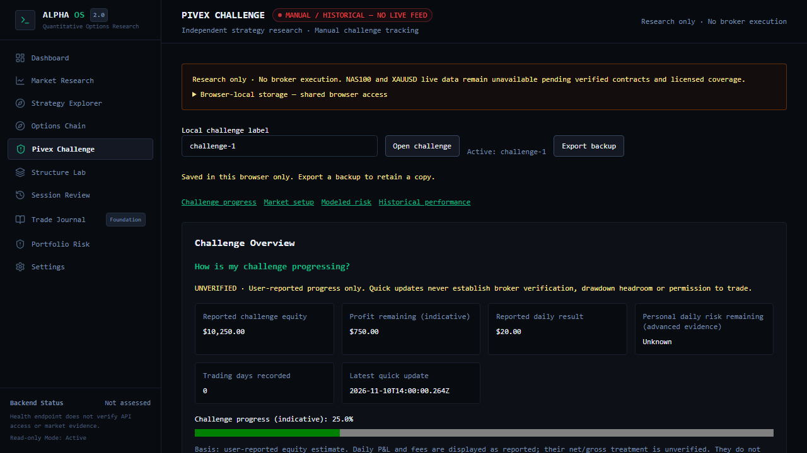
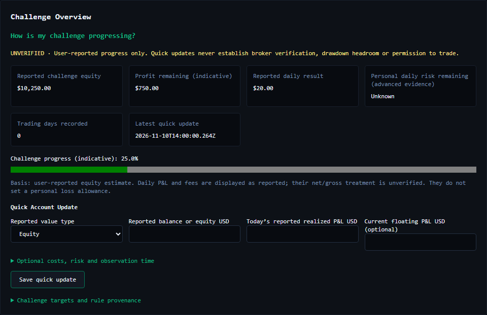
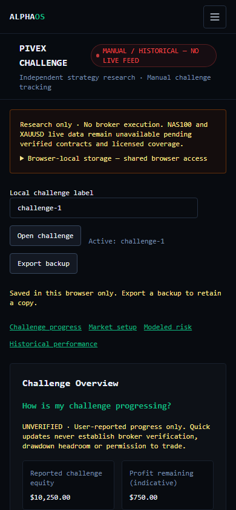
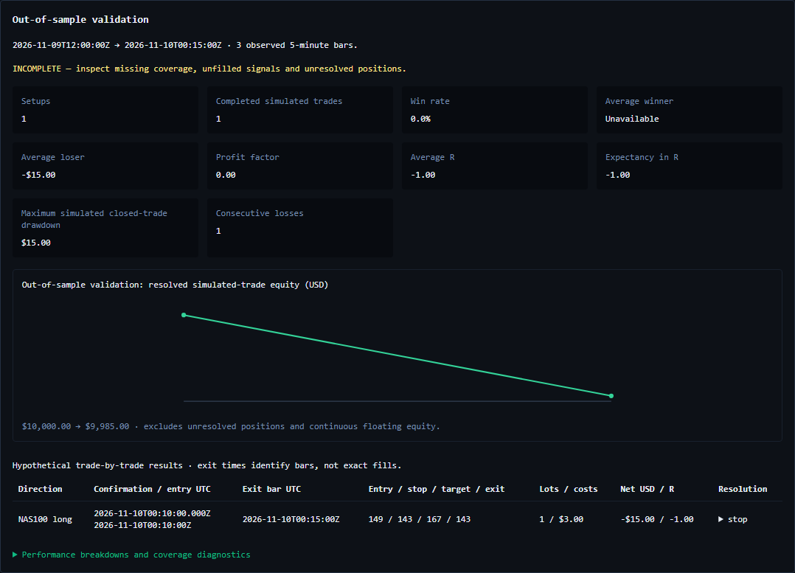
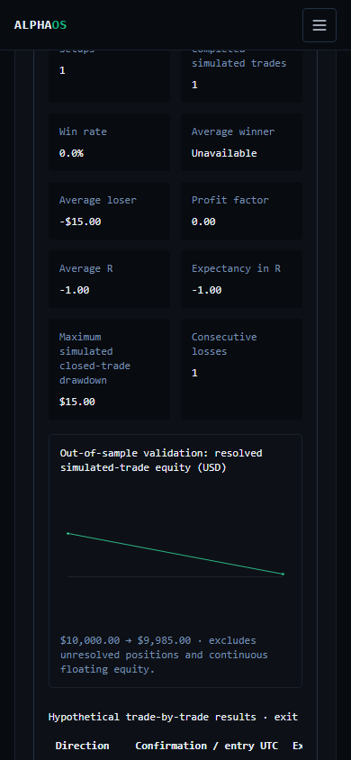

# Pivex data, usability and replay milestone

This extends the existing `/pivex` dashboard from merged PR #92. It preserves `strategy.ts`, options research, archive storage, website authentication and charting files. No production deployment, broker connection, subscription, database migration or cloud synchronization is introduced.

## Staged acceptance

| Stage | Working behavior | Boundary / remaining dependency |
| --- | --- | --- |
| 1. Quick account updates | Two required numbers (reported equity/balance and today's realized P&L), optional floating P&L, fees and open risk; timestamp defaults to now. Indicative progress, remaining target, recorded days and source/time persist locally. | Always user-reported and UNVERIFIED. Balance without floating evidence stays balance-based. Gross/net fee treatment is unknown; these fields cannot establish daily risk headroom. |
| 2. Advanced verification | Existing complete UTC daily/weekly baseline, cumulative gross P&L, costs, exposure, counts and rule provenance retained behind expandable panels. | A quick save invalidates the strict observation. Advanced observations older than a quick report are rejected. Existing 15-minute freshness and midnight rules still apply. No broker-verified status is claimed. |
| 3. Historical evidence | `HistoricalExportAdapter` implements the existing `MarketDataAdapter`, supports sourced completed 1H/15M/5M candles and pre-existing target observations, checks mappings, ticks, order and timestamp alignment. | No approved provider credentials or matching usage rights were available in this task. Exact Pivex contract mapping remains user-attested. No QQQ/futures/spot substitution or network download is enabled. |
| 4. Deterministic replay | Unchanged strategy replay, next-bar execution model, fixed lots/costs, net 2R and $25 maximum entry risk, chronological equity/trade results, separate development/validation windows, conservative ambiguity/gap treatment. | Hypothetical results only. Sparse or incomplete coverage is conspicuous. Neither profitable results nor account reports qualify live trading. |
| 5. Persistence | Existing schema-1 browser backup compatibility, optional versioned quick reports, explicit idempotent merge by stable IDs, collision rejection, challenge-label isolation and stale-tab protection. | Shared-password website sessions cannot establish individual ownership. Local storage remains active; see the separate secure-storage plan. |

The page answers four questions through navigation links: challenge progress, market setup, modeled risk and historical performance. Detailed contract/evidence/configuration inputs and closed-trade forms are expandable. Actual user reports, manual history, synthetic fixtures and hypothetical backtests retain separate labels and storage paths. No verified live observations exist in this milestone.

## Quick-report accounting

`progress.ts` validates UTC dates, finite numeric inputs, nonnegative optional costs/risk, explicit `kind: user_reported`, source and schema version. New reports must not be future-dated. Optional missing values remain `null`, not invented zeroes. The newest observation is displayed (last entry wins timestamp ties).

Equity reports use the entered equity directly for **indicative** progress. Balance reports with entered floating P&L display their sum as a reported equity estimate; without floating P&L, equity remains unknown and the target estimate is explicitly balance-based. Neither calculation subtracts fees again: the app does not know whether the reported balance/P&L already includes them. The daily reported number is displayed as reported. A quick report never supplies an official UTC baseline, complete loss count or a personal daily allowance. That allowance comes only from a fresh comprehensive observation.

Quick reports are optional `quickReports` on the existing schema-1 ledger, each with their own schema-1 record and UUID. Old backups still validate. Import/export preserves provenance. Merge retains current contract specs and active rule configuration, merges distinct rule provenance/trade/report IDs, rejects differing contents under one ID, clears the account observation, and is idempotent on repeat import. It does not identify economically identical trades with different UUIDs; review such imports manually. Replacement import remains explicitly labeled. Nothing migrates to a server automatically.

## Historical provider assessment — reviewed 10 November 2026

### Instrument identity first

Pivex publicly lists NAS100 and gold XAUUSD/XAU/USD on Match-Trader. Its [lot guidance](https://help.pivex.com/en/support/solutions/articles/156000324626-are-there-any-restrictions-on-lot-size-volume-or-number-of-trades-) describes indices as one contract per lot and gold as 100 ounces per lot. Its [trade instructions](https://help.pivex.com/en/support/solutions/articles/156000378835-how-to-place-a-trade-) use XAUUSD. These do **not** establish this account's exact symbol suffix, tick value, minimum/maximum lot, increment, quote basis, trading schedule, financing or historical spec changes.

Obtain the active account's contract/specification export and written data-use permission before connecting a feed. Record broker and provider symbols separately, instrument type, reference to the account contract, tick size/value, quote-to-USD conversion, lot rules, schedule, effective dates and cost convention. NAS100 CFDs, Nasdaq index values, NQ futures and QQQ are distinct instruments; spot XAU/USD and a Pivex gold CFD are likewise not equivalent. The import adapter requires an explicit Pivex-CFD mapping for manual history (synthetic type for fixtures) and rejects known ETF/futures proxies. Attestation is not independent verification of equivalence or licensing.

| Candidate | Coverage / instrument match | Granularity, timestamps, depth and quality | Cost / limits | Commercial rights and decision |
| --- | --- | --- | --- | --- |
| Authorized Pivex/Match-Trader export | Best potential exact match **if** this account supplies actual symbols/specs and usable candle history. Public availability of a candle export/API was not verified. | Request completed 1H/15M/5M bars, explicit timezone and quote basis; inspect completeness and cross-timeframe closes. Depth and session calendar remain account-dependent and unverified. | Export access/cost not established; no paid service ordered. | Obtain written research/storage/display rights and approval of any automated access. Selected implementation is a local normalized-export adapter, not a claim that Pivex supplies an approved API. |
| Twelve Data | Catalog identifies [XAU/USD as aggregate spot gold](https://twelvedata.com/exchanges/commodity), not this Pivex CFD. Broker-exact NAS100 coverage not established. | Catalog advertises commodity intraday intervals from 1 minute to 8 hours starting January 2020; symbol/interval depth must be checked with `earliest_timestamp`. Normalize source timestamps to UTC, preserve gaps; aggregate-feed sessions do not define Pivex hours. | [Basic](https://twelvedata.com/pricing) lists 8 API credits/minute and 800/day. [Business](https://twelvedata.com/pricing-business) lists Venture $499/month and Enterprise $1,099/month billed monthly; add-ons may apply. Free access does not establish entitlement to a specific instrument. | [Usage policy](https://support.twelvedata.com/en/articles/5332349-commercial-and-personal-usage) separates internal/personal use from commercial display and requires a separate redistribution agreement. Candidate only; no key, broker equivalence or approved redistribution agreement available. |
| OANDA v20 | OANDA account instruments are broker/region-dependent; no Pivex equivalence is assumed for its index/metals products. | [API definitions](https://developer.oanda.com/rest-live-v20/instrument-df/) expose M5/M15/H1 and a completed flag. [Candle endpoints](https://developer.oanda.com/rest-live-v20/pricing-ep/) cap count at 5,000 and expose price components. [Introduction](https://developer.oanda.com/rest-live-v20/introduction/) advertises history back to 2005 generally; verify each instrument. UTC normalization must handle fractional precision and bid/ask/mid distinctions. No guaranteed gap-free depth was established. | Demo account option is advertised; no commercial data-license price established. Requires authorized account/token and regional instrument availability. | [API license](https://docs.oanda.com/6817bbf2-068b-4000-bc1c-86b13d60b2de/API_License_Agreement_-_February_2023.pdf) describes internal use separately from third-party access. Obtain current applicable redistribution permission/quote. Not enabled. |
| Dukascopy/JForex export | Broker-specific index/commodity data may be useful for separate research; no matching Pivex CFD established. | [Historical export](https://www.dukascopy.com/swiss/english/marketwatch/historical/) and [commodity page](https://www.dukascopy.com/swiss/english/cfd/range-of-markets/cfd-commodities/) describe tick-to-monthly downloads. Derive/obtain 5M/15M/1H only with a declared alignment and closed-market calendar; symbol-specific first date and missing-bar quality not established here. | Public export exists; no specific commercial redistribution price or account quota verified. Do not infer that free download means a commercial license. | [Published terms](https://www.dukascopy.com/media/docs/eu/actual/1.Terms-and-Conditions.pdf) restrict disclosure/dissemination of API data. Negotiate applicable rights before public AlphaOS display/distribution. Not enabled. |

No candidate was proven to deliver this account's exact instrument under authorized commercial terms, so no remote requests, subscriptions or credentials were added. Existing options archives are not a substitute. Provider prices/terms above are dated observations, not quotes or legal clearance.

### Connection procedure and supported fallback

1. Obtain contract mapping and permitted historical-data use in writing. Confirm account stage, instrument suffix/type, market hours, tick and lot values, effective dates and price basis. Keep secrets server-side if a future approved remote transport is introduced.
2. Obtain authorized completed candles from the account/broker or an explicitly approved matching source. Preserve original files, UTC conversion method, vendor timestamps, known closures and gaps; do not interpolate. No broker credentials should be pasted into the dashboard.
3. Normalize into the `HistoricalDataset` schema in `web/src/lib/pivex/history.ts`: `schema:1`, instrument/source/mode, explicit mapping/rights reference, arrays of completed candles, tick size/buffer and chronologically timestamped target observations. Targets must describe structures known before each signal, not handpicked future highs/lows. Manual imports use `mode: manual_historical` and `mapping.instrumentType: pivex_cfd`.
4. Enter matching historical contract/cost assumptions in `BacktestConfig`: windows, starting hypothetical equity, fixed lots, risk budget up to $25 and complete `ContractSpec`. The spec's broker symbol and tick size must match the dataset. Cost assumptions are not current live cost verification. No credentials are accepted.
5. Open **Historical import and execution assumptions**, paste dataset/config JSON and run. The synthetic replay buttons provide a complete schema example, but are never market history. Each import is bounded to 5 MB, each timeframe to 10,000 rows and each replay partition to 2,000 entry bars. These are deliberately bounded browser research runs, not an institutional batch backtester.
6. Review diagnostics and individual trades before using any metric. The result retains source, data mode, execution model and configuration. To reproduce, retain the exact input JSON, output JSON and code commit. Exported account/journal backups intentionally do not mix in hypothetical backtest trades.

## Replay and execution assumptions

`backtest.ts` calls the original `analyze()` in `strategy.ts`; no indicator, trend, breakout, buffer or target rule changed. Every call sees only completed bars at the current replay time. Hourly and setup bars are further cut at the confirmation candle's **opening** time by the strategy. A pre-existing target is chosen only from observations at/before that opening time. Future observations cannot validate development signals.

At each missing timeframe interval, the adapter passes only the contiguous suffix. This resets EMA warm-up rather than letting a gap masquerade as continuous history. The strategy still requires its original 23 hourly, three 15-minute and two 5-minute bars. Declared non-trading periods are sourced annotations, not an invented universal calendar. Missing leading/trailing window coverage and interior gaps are surfaced. Off-tick, unfinished, overlapping, duplicate and misaligned bars are rejected. Conflicting same-timeframe closes fail in the unchanged analyzer.

Execution model `pivex-replay-v1`:

- One position at a time, fixed declared lots validated against min/max/step. No averaging, pyramiding or stop changes. Position entry uses the **observed open of the exact contiguous next candle**, never the confirmation close or a guessed missing price. Entry is rejected if the original stop/target geometry has already failed, net target reward/risk after costs is below 2, or planned loss exceeds the lesser of the declared risk budget and available simulated equity.
- Gross P&L is directional price difference / tick size × tick value × quote-to-USD conversion × lots. Round-trip spread/slippage are declared tick costs, commission is USD/lot and fixed fees are USD. Costs are charged once per resolved round trip. No bid/ask series is reconstructed. The declared model represents a reference-price series plus these costs; importing bid/ask data requires reviewing the spread assumption to avoid double counting. Financing, variable liquidity and time-varying costs remain unmodeled unless included in declared costs.
- Stops and targets are fixed by the original signal. A touched stop uses its level under the declared execution assumption. An adverse open beyond a stop uses the observed open plus declared costs and may exceed planned risk. A target limit receives no favorable gap improvement. These are **modeled fills**, not assertions that liquidity guarantees execution.
- If stop and target both occur inside one bar, sequence is unknown: classify `ambiguous_stop_first` and conservatively use the stop loss. It cannot be counted as a certain winner. Exact intrabar fill times are unavailable; output exit timestamps identify the bar close.
- Missing bars while a position is open leave its exit/P&L **unresolved**, stop that partition, and produce no subsequent invented portfolio trajectory. Open positions at window end remain unresolved; no forced closing fill is fabricated. Unresolved trades are excluded from resolved metrics and the curve, clearly flagged as incomplete.
- Equity curves and maximum simulated drawdown use the resolved-trade net curve, not continuous floating or tick equity. They do not certify Pivex's equity-based drawdown rules. Daily/weekly challenge limits, margin, financing, news windows, trade-count rules and complete live portfolio compliance are not simulated by this fixed-lot strategy experiment.

Development `[from, splitAt)` and validation `[splitAt, to)` are independent, nonoverlapping executions, each with its own starting hypothetical equity. No open position carries across the split. Earlier historical candles can warm validation indicators; future validation candles cannot enter development. The user declares the split before running; software cannot prove that the user did not select or retune on validation results. No automatic parameter search or performance optimization is introduced.

Metrics include setup count, completed simulated trades, net win rate, net average winner/loser, profit factor, average/expected R, resolved-equity maximum drawdown, consecutive losses, instrument/session/direction groups and the existing bullish/bearish trend classification. Unknown denominators remain unavailable. Market-condition groups are **not** a new regime classifier. UTC sessions reuse existing bins, not DST-aware broker sessions.

The synthetic sample has sparse arbitrary bars, one development target and one validation stop. Its missing-window coverage is intentionally flagged. It demonstrates mechanics and adverse validation, not historical profitability, reliable liquidity, a recommendation or a verified account record.

From `web`, run `node --experimental-strip-types scripts/pivex-replay-example.mjs` to regenerate the committed [synthetic input](pivex-upgrade-evidence/synthetic-input.json) and [result](pivex-upgrade-evidence/synthetic-result.json). No vendor data, credentials or account records are accessed. The saved input's `dataset` and `config` properties match the two UI editors.

## Validation and browser evidence

Run Python regression, `npm test`, `npm run typecheck`, `npm run build`, and Chromium. New tests in `pivex-upgrade.test.mjs` cover reports/provenance, immutable storage boundaries, backup compatibility/deduplication, mapping/rights rejection, alignment and warm-up, no-lookahead, next-bar entries, costs/FX/lot rules, ambiguity, gaps, unresolved fills, drawdown/metrics and unauthorized persistence access. Browser tests exercise quick save/reload/export/merge, strict NO TRADE after partial reports, both account views and clearly separate synthetic replay results.

Local validation on 10 November 2026:

| Check | Result |
| --- | --- |
| Python regression | 1,487 passed, one skipped, 64 subtests passed; five existing dependency warnings. 348.78 seconds, existing Python 3.12 environment and a fresh writable task-specific pytest temp directory. |
| Website unit suite | 314 passed, including 39 new upgrade cases. |
| Chromium full regression | 65 passed; two existing login tests skipped by the default Next harness. Four Pivex browser flows also reran successfully after the final compact-header and screenshot changes. |
| TypeScript | Passed (`npm run typecheck`). |
| Production Next build | Passed (`npm run build`). No deployment. |

The local Node version is 24.20.0; the repository declares a newer minimum. Pinned GitHub CI validation must pass before promotion. Live CI status is reported on the draft PR against its exact head commit; this document does not pre-certify a future run.

Desktop/mobile evidence below uses test reports and synthetic backtests **only**; it contains no verified market prices or actual account balances.

The [secure storage implementation plan](pivex-secure-storage-plan.md) records the identity dependency and future authorization/RLS/migration gates. No deployment or merge is part of acceptance.
